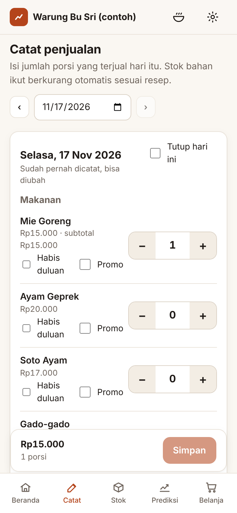
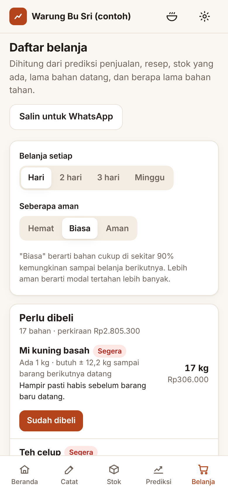
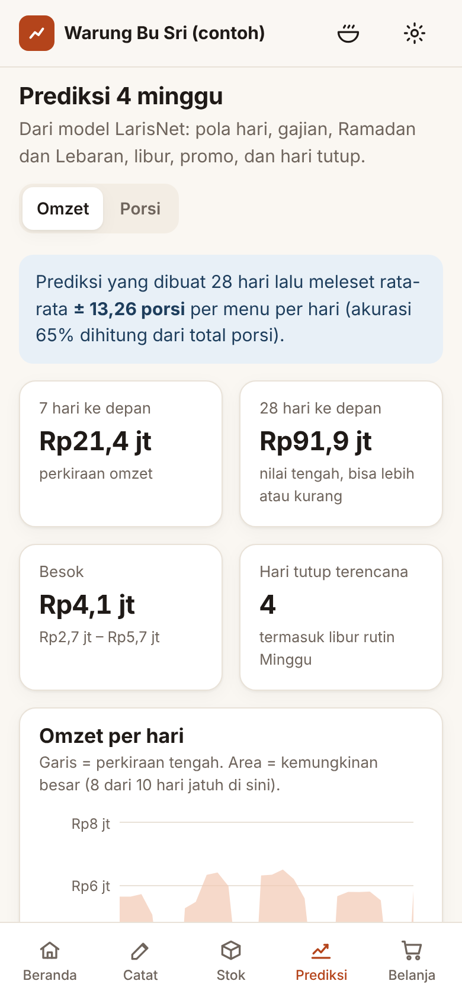
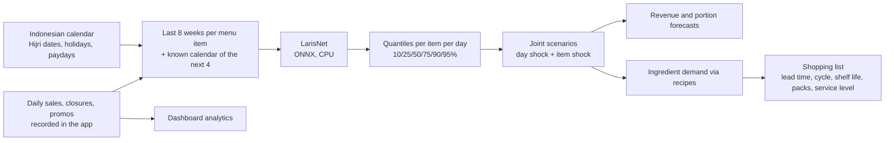

# Laris

[](https://github.com/Epinnn14/laris/actions/workflows/ci.yaml)

**Sales analytics, demand forecasting and ingredient planning for Indonesian warung makan and cafés.**
*Catat penjualan, pantau stok bahan, dan tahu besok harus belanja apa.*

A small food stall decides every evening how much chicken, rice and milk to buy for tomorrow.
Buy too little and the best seller runs out at lunch. Buy too much and fresh ingredients spoil.
Laris turns the daily sales the owner already writes down into answers to three questions:

1. **How is the business doing?** Revenue, gross profit, best sellers with ABC classes and
   margins, and which days were busy or quiet compared with the usual for that weekday.
2. **How much will each menu item sell in the next 4 weeks?** Probabilistic forecasts from a
   transformer trained for this setting. It knows weekdays, paydays, Ramadan, Lebaran,
   national holidays, promotions and planned closures.
3. **What should I buy, and how much?** A shopping list that turns menu forecasts into ingredient
   needs through the recipes, and accounts for stock on hand, delivery lead times, shelf life,
   pack sizes and how often the owner shops.


<p align="center">

</p>

The app is in Indonesian and built for phones first. It runs on a laptop with one
`docker compose up`, or online for free (Render + Neon). The model runs on CPU through
onnxruntime, so it needs no GPU and no internet. Owners: see the [Indonesian guide](docs/PANDUAN.md).

## How it works



**Recording drives everything.** When the owner saves a day's sales, the ingredients the recipes
used are booked as stock movements. Stock is the sum of its movements: purchases, use, waste and
stock counts. Every number can be traced, and editing a past day rebooks its usage.

### The model: LarisNet

- **Input:** 56 days of an item's history (sales scaled by its recent average, closed days,
  stock-outs, promos) and the known features of the next 28 days. The 21 known features cover
  day of week, day of month, payday and *tanggal tua*, Ramadan and its progress, the weeks before
  and after Idul Fitri, Idul Adha, national holidays, long weekends, school holidays and year end,
  plus planned closures and promos. The item category and business type are also inputs.
- **Architecture:** past and future days form one 84-token sequence for a 3-layer transformer
  encoder (d=64, 110k parameters). The head outputs 6 quantiles as cumulative softplus steps,
  so they are never negative and never cross. Training uses pinball loss and skips closed days
  and stock-out days, because a stock-out only gives a lower bound on demand.
- **Robust to new items:** during training, 20% of windows have most of their history hidden.
  The model therefore learns to forecast an item from as little as one week of sales.
- **Hijri calendar:** Ramadan and Lebaran move about 11 days earlier each year. Their dates are
  computed (Umm al-Qura via `hijridate`) rather than learned from day-of-year.

### Training data

Real shop sales are private and scarce. So the model is pretrained on a simulator of Indonesian
food businesses ([`synth.py`](ml/laris_ml/synth.py)) that encodes what owners describe:

- **Location rhythms:** busy weekdays near offices and campuses, busy weekends in housing areas
  and tourist spots, semester breaks.
- **Money:** more spending after payday, less at the end of the month.
- **Ramadan:** fewer lunches, but gorengan and iced drinks sell for berbuka. Late Ramadan is
  quieter as people travel home.
- **Lebaran:** many shops close for mudik, and cities stay quiet for two weeks afterwards.
- **Weather:** rainy days sell hot drinks and fewer iced ones.
- **Menu life:** new items ramp up, tastes drift slowly, and items are dropped.
- **Day-to-day variation:** promos, stock-outs, random closures, and negative-binomial noise.

Every simulated shop draws its own parameters, so the model learns the patterns rather than one
shop. The same simulator fills the app's demo shop.

### Results

Evaluated on 120 simulated shops the model never saw, as 28-day forecasts in three situations
(`python -m laris_ml.evaluate`; CI reruns it on every push):

**Normal weeks** (1278 forecasts of 28 days)

| Method | MASE | wQL | 80% band coverage | MAE (portions/day) |
|---|---|---|---|---|
| **LarisNet** | 0.66 | 0.19 | 79% | 8.77 |
| Same day last week | 1.019 | 0.331 | 76% | 14.47 |
| Weekday average (8 wk) | 0.778 | 0.241 | 64% | 10.51 |
| LightGBM (lags + calendar) | 0.693 | 0.2 | 79% | 9.23 |

**Around Lebaran** (2522 forecasts of 28 days)

| Method | MASE | wQL | 80% band coverage | MAE (portions/day) |
|---|---|---|---|---|
| **LarisNet** | 0.592 | 0.202 | 79% | 6.78 |
| Same day last week | 0.985 | 0.354 | 78% | 11.54 |
| Weekday average (8 wk) | 0.799 | 0.294 | 59% | 9.33 |
| LightGBM (lags + calendar) | 0.627 | 0.216 | 77% | 7.19 |

**New items (14 days of history)** (1296 forecasts of 28 days)

| Method | MASE | wQL | 80% band coverage | MAE (portions/day) |
|---|---|---|---|---|
| **LarisNet** | 0.304 | 0.211 | 80% | 7.62 |
| Same day last week | 0.46 | 0.393 | 55% | 12.68 |
| Weekday average (8 wk) | 0.391 | 0.355 | 28% | 9.96 |
| LightGBM (lags + calendar) | 0.343 | 0.244 | 76% | 8.65 |

In all three situations LarisNet has the lowest error and the most honest uncertainty: its 80%
band holds about 80% of real values. The weekday average, which is what most owners do in their
heads, covers only 28–64%. Compared with that rule, the median error is 17% lower in normal
weeks, 27% lower around Lebaran, and 23% lower for new menu items. A tuned LightGBM with lag and
calendar features comes close in normal weeks, but falls further behind when history is short
or Lebaran shifts the pattern.

**Metrics:**

- **MASE:** error of the median relative to "same day last week" on that item's history. Lower
  is better; below 1 beats the naive rule.
- **wQL:** weighted quantile loss over the 10/50/90% quantiles. It scores the whole range, not
  just the middle.
- **Coverage:** how often the actual value fell inside the 10–90% band. 80% is ideal.

**Limits:** these numbers come from simulated shops. Real shops are messier, which is why the app
also reports its own backtest: how far off the forecast made 4 weeks ago was from what was
actually sold. Retraining with more data and a bigger model on a free GPU takes one notebook:
[`notebooks/train_larisnet.ipynb`](notebooks/train_larisnet.ipynb) (Colab or Kaggle).

### From forecasts to a shopping list

Quantiles per item are not enough to know how much beras to buy, because that needs the
distribution of a *sum* over several items and days. [`plan.py`](ml/laris_ml/plan.py) samples
800 joint scenarios through a Gaussian copula:

- one shock per day, because the whole street is busy or quiet together,
- one shock per item, because an item selling well today tends to sell well tomorrow.

Each scenario is converted to ingredient use through the recipes. For every ingredient, the order
then covers the lead time plus the days until the next shopping trip, at the chosen service
level (Hemat 80%, Biasa 90%, Aman 95%). It is rounded up to whole packs, except fast-spoiling
items, which are capped at what will be used before they go bad. The list includes a stock-out
risk and a plain-language reason for each item, and copies to WhatsApp in one tap.

## Run it

```bash
docker compose up -d            # http://localhost:8000, data in the laris-data volume
```

- **Online for free:** [docs/DEPLOY.md](docs/DEPLOY.md) covers Render free web service plus
  Neon free Postgres, using the included `render.yaml`.
- **Public demo:** `LARIS_DEMO_MODE=1` starts without a password and with a year of demo data.

Development:

```bash
pip install -e "ml[train,test]" -e "backend[test]"
uvicorn laris_api.main:app --reload            # API on :8000
cd frontend && npm ci && npm run dev           # app on :5173, proxied to the API
python -m laris_ml.train --shops 400 --steps 4000 --out models/larisnet   # ~40 min on 2 CPU cores
python -m laris_ml.evaluate --model models/larisnet
```

## Layout

```
ml/laris_ml/        calendar_id (Indonesian calendar), synth (simulator), features, model, trainset,
                    train, evaluate, baselines, forecast (onnxruntime), plan (scenarios + shopping list)
backend/laris_api/  FastAPI: auth, records, stock ledger, analytics, forecasts, demo data
frontend/src/       React + TypeScript + Recharts, mobile-first, Indonesian
models/larisnet/    model.onnx + meta.json + eval results (the app's model)
notebooks/          training on Colab / Kaggle GPUs
docs/               owner guide (ID), deployment (ID)
```

## Tests and CI

- **ML:** calendar, simulator reproducibility, trainer–app feature parity (the app builds exactly
  what the model was trained on), baselines, and the shopping-list logic. CI also runs a short
  CPU training as a smoke test.
- **Model:** the committed model is evaluated against the baselines in CI, and the table is
  posted in the job summary.
- **Backend:** API tests (auth, sales booking ingredients, stock counts, closures, demo,
  forecasts, plan, CSV export) run on both SQLite and PostgreSQL.
- **Web:** type-checked build, then a Playwright run at phone and desktop size against a demo
  server. It opens every page, records a sale, buys stock, and fails on console errors, failed
  API calls or sideways scrolling.
- **Docker:** the image is built and smoke-tested, checking that the model is loaded and the
  forecast comes from LarisNet.
