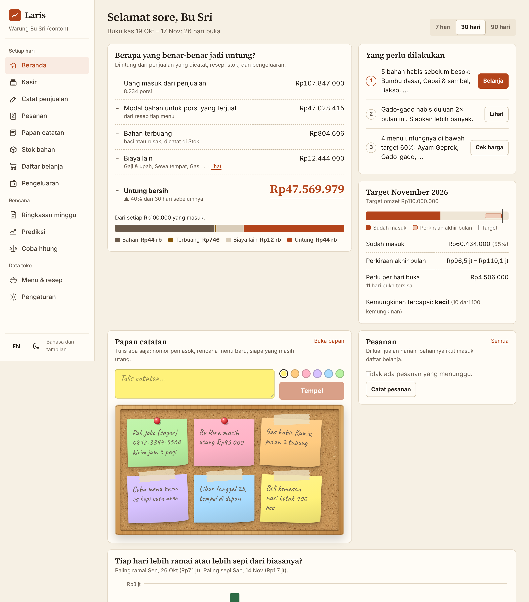
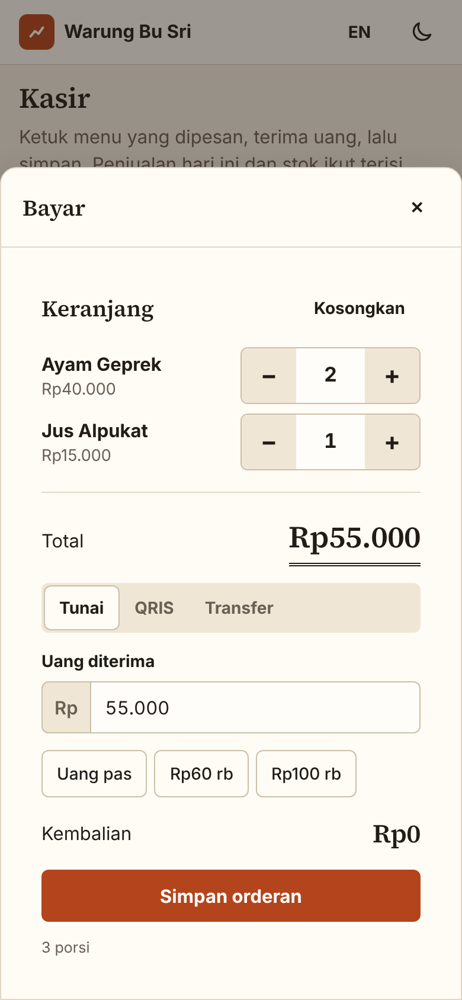
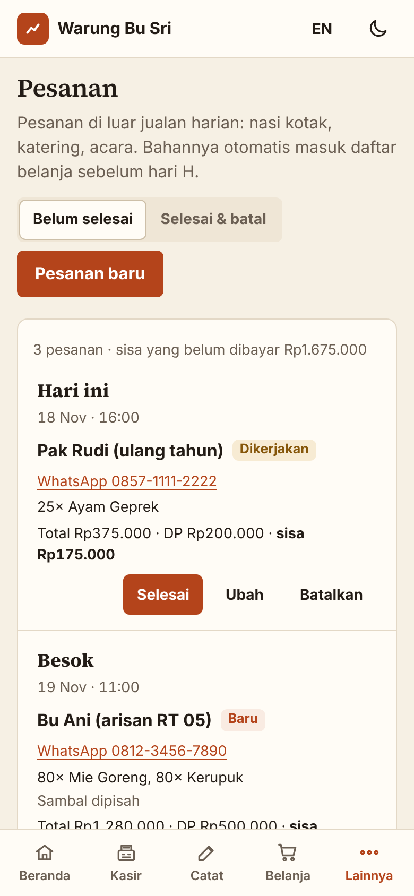
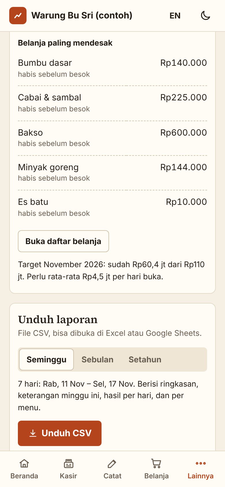
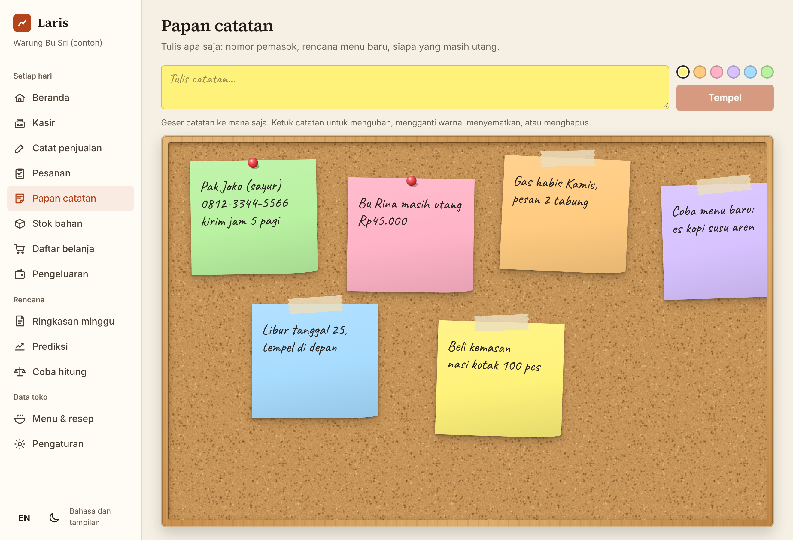
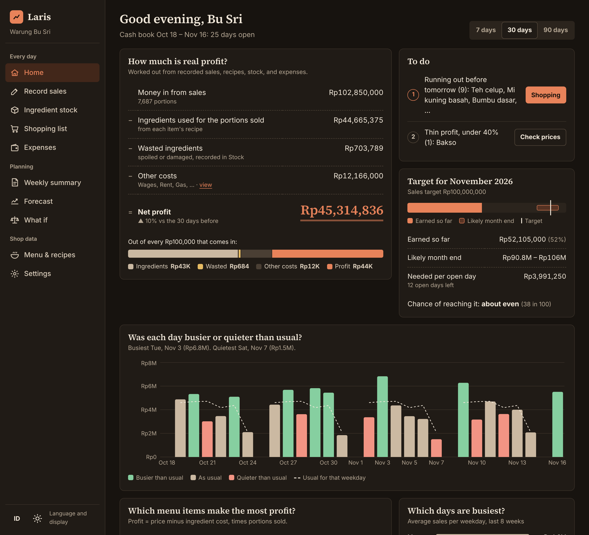
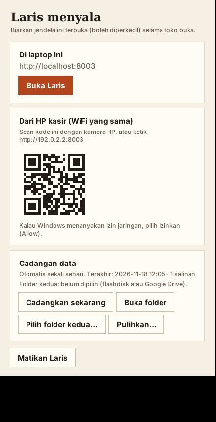
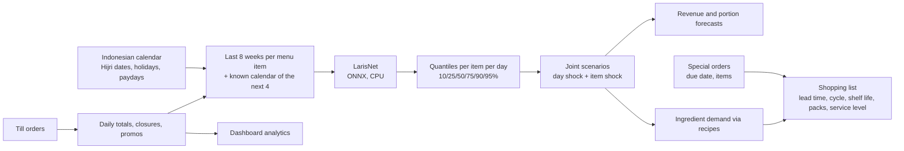

# Laris

[](https://github.com/Epinnn14/laris/actions/workflows/ci.yaml)
[](https://github.com/Epinnn14/laris/actions/workflows/windows.yaml)
[](https://github.com/Epinnn14/laris/releases/latest)

**Sales analytics, till, demand forecasting and ingredient planning for Indonesian warung makan,
cafés and grocery kiosks.** Runs offline on the shop laptop and opens on any phone on the same WiFi.
*Catat penjualan, pantau stok bahan, dan tahu besok harus belanja apa.*

**Download for Windows:** [Laris.exe](https://github.com/Epinnn14/laris/releases/latest/download/Laris.exe) (always the latest version).
No Docker, no terminal: install, scan the QR code with the cashier's phone, sell.
Indonesian setup guide: [docs/PASANG.md](docs/PASANG.md).

A small food stall decides every evening how much chicken, rice and milk to buy for tomorrow.
Buy too little and the best seller runs out at lunch. Buy too much and fresh ingredients spoil.
Laris turns what the shop already records, orders at the till or the day's totals in the evening,
into answers to three questions:

1. **How is the business doing?** A cash-book statement from sales down to net profit (ingredients
   used, waste, and running costs such as gas, rent and wages), progress towards the monthly
   target with the likely month end, which items earn the most, and which days were busy or quiet
   compared with the usual for that weekday.
2. **How much will each menu item sell in the next 4 weeks?** Probabilistic forecasts from a
   transformer trained for this setting. It knows weekdays, paydays, Ramadan, Lebaran,
   national holidays, promotions and planned closures.
3. **What should I buy, and how much?** A shopping list that turns menu forecasts into ingredient
   needs through the recipes, and accounts for stock on hand, delivery lead times, shelf life,
   pack sizes and how often the owner shops.



<p align="center">


</p>

## Features

**Recording sales**

- **Till (kasir):** tap items, take cash, QRIS or transfer with the change worked out, save, cancel
  if needed. Each order adds to the day's totals, so stock, the dashboard and the forecast follow
  the till. Several phones can sell at once; the dashboard shows today's live numbers and the
  busiest hours.
- **Daily totals:** shops without a till type how many portions of each item sold, in the evening.
  Closed days, regular days off, sold-out items and promotions are marked so the forecast learns
  from them correctly.
- **Special orders (pesanan):** boxed meals and catering with customer, WhatsApp number, due date
  and time, down payment and status. Their ingredients are added to the shopping list before they
  are due; finished orders count in the money but stay out of the forecast's history.

**Money**

- **Cash book:** sales down to net profit (ingredients used, waste, and other costs), and how each
  Rp100,000 that comes in splits into ingredients, waste, costs and profit.
- **Expenses** (gas, electricity and water, rent, wages, packaging, transport) so net profit is real.
- **Monthly target** with progress, the likely month end, the chance of reaching it and what is
  needed per open day.
- **Simple costing:** "I spend Rp120,000 and it makes 30 portions" sets the cost per portion;
  linking ingredients is optional and only needed for automatic stock.
- **Price suggestions** from the cost per portion and the wished margin (10–90%).
- **What if:** a new price or a promotion for one item, compared with the current forecast for
  the next 4 weeks. The promotion effect comes from the model; the price effect uses a rough
  price sensitivity the owner picks, and the page says so.

**Stock and shopping**

- **Ingredient stock** goes down by itself with every sale. Purchases, waste and stock counts are
  one tap each, and every movement is listed.
- **The owner's own ingredients:** add new ones, edit name, pack and price, hide those no longer
  used (and bring them back), or remove them from every recipe. Ingredients with purchase history
  are hidden rather than deleted, so old records keep their names.
- **Shopping list** per trip, from the forecast, the recipes and the special orders, with the
  reason for each item, copied to WhatsApp in one tap.

**Reports**

- **Weekly summary** in plain sentences: what rose, what fell, best sellers, what needs attention,
  sales tips for next week, expected sales and most urgent purchases, copied to WhatsApp.
- **CSV reports for a week, a month or a year,** named after the shop
  (`Warung Bu Sri-hasil seminggu.csv`, `…-hasil sebulan November 2026.csv`,
  `…-hasil setahun 2026.csv`). Each has the money summary, a plain-words note for every week
  (up or down on the week before, best seller, busiest day, items that sold out early, days not
  recorded, days closed), results per day or per month, per menu item and per expense type. They
  open in Excel or Google Sheets, in Indonesian or English. All sales since the start can also be
  downloaded as one table.

**Every day**

- **Notes board:** sticky notes on a cork board for a supplier's number, a new dish idea, or who
  still owes money. Drag them anywhere (mouse, finger or arrow keys), pick one of six paper colours,
  pin the important ones; pinned notes come first in the strip on the dashboard.

**Setting up and keeping data safe**

- **Sign-up wizard** for new shops: name, owner, type (warung makan, café, or kios / toko
  kelontong), open days, shopping habit, monthly target and wished margin, then the menu actually
  sold (picked from a sample menu with the owner's prices, typed in, or sample data to try first).
  Settings → **Start over** wipes the shop after a backup to go through it again.
- **Backups:** a daily copy on the laptop (30 kept), an optional second folder (flash drive or
  Google Drive), and restore from the laptop window.
- **Light and dark** display and **Indonesian or English**.
- **Kios / toko kelontong:** each good is its own stock. The model has only seen warung and café
  patterns, so a kios is forecast with the warung pattern; the in-app backtest shows how well that
  fits after four weeks.





<p align="center"></p>

The app is built for phones first. On a shop laptop it is one Windows installer; it also runs
with `docker compose up`, or online (Render + Neon). The model runs on CPU through onnxruntime,
so it needs no GPU and no internet. Owners: see the [Indonesian guide](docs/PANDUAN.md).

## How it works



**Recording drives everything.** Each till order adds to the day's totals, and the owner can also
type the totals in the evening. When a day's sales change, the ingredients the recipes used are
booked as stock movements. Stock is the sum of its movements: purchases, use, waste and
stock counts. Every number can be traced, and editing a past day rebooks its usage.

### The model: LarisNet

- **Input:** 56 days of an item's history (sales scaled by its recent average, closed days,
  stock-outs, promos) and the known features of the next 28 days. The 21 known features cover
  day of week, day of month, payday and *tanggal tua*, Ramadan and its progress, the weeks before
  and after Idul Fitri, Idul Adha, national holidays, long weekends, school holidays and year end,
  plus planned closures and promos. The item category and business type are also inputs.
- **Architecture:** past and future days form one 84-token sequence for a 3-layer transformer
  encoder (d=64, 110k parameters). The head outputs 6 quantiles as cumulative softplus steps,
  so they are never negative and never cross. Training uses pinball loss and skips closed days
  and stock-out days, because a stock-out only gives a lower bound on demand.
- **Robust to new items:** during training, 20% of windows have most of their history hidden.
  The model therefore learns to forecast an item from as little as one week of sales.
- **Hijri calendar:** Ramadan and Lebaran move about 11 days earlier each year. Their dates are
  computed (Umm al-Qura via `hijridate`) rather than learned from day-of-year.

### Training data

Real shop sales are private and scarce. So the model is pretrained on a simulator of Indonesian
food businesses ([`synth.py`](ml/laris_ml/synth.py)) that encodes what owners describe:

- **Location rhythms:** busy weekdays near offices and campuses, busy weekends in housing areas
  and tourist spots, semester breaks.
- **Money:** more spending after payday, less at the end of the month.
- **Ramadan:** fewer lunches, but gorengan and iced drinks sell for berbuka. Late Ramadan is
  quieter as people travel home.
- **Lebaran:** many shops close for mudik, and cities stay quiet for two weeks afterwards.
- **Weather:** rainy days sell hot drinks and fewer iced ones.
- **Menu life:** new items ramp up, tastes drift slowly, and items are dropped.
- **Day-to-day variation:** promos, stock-outs, random closures, and negative-binomial noise.

Every simulated shop draws its own parameters, so the model learns the patterns rather than one
shop. The same simulator fills the app's demo shop.

### Results

Evaluated on 120 simulated shops the model never saw, as 28-day forecasts in three situations
(`python -m laris_ml.evaluate`; CI reruns it on every push):

**Normal weeks** (1278 forecasts of 28 days)

| Method | MASE | wQL | 80% band coverage | MAE (portions/day) |
|---|---|---|---|---|
| **LarisNet** | 0.66 | 0.19 | 79% | 8.77 |
| Same day last week | 1.019 | 0.331 | 76% | 14.47 |
| Weekday average (8 wk) | 0.778 | 0.241 | 64% | 10.51 |
| LightGBM (lags + calendar) | 0.693 | 0.2 | 79% | 9.23 |

**Around Lebaran** (2522 forecasts of 28 days)

| Method | MASE | wQL | 80% band coverage | MAE (portions/day) |
|---|---|---|---|---|
| **LarisNet** | 0.592 | 0.202 | 79% | 6.78 |
| Same day last week | 0.985 | 0.354 | 78% | 11.54 |
| Weekday average (8 wk) | 0.799 | 0.294 | 59% | 9.33 |
| LightGBM (lags + calendar) | 0.627 | 0.216 | 77% | 7.19 |

**New items (14 days of history)** (1296 forecasts of 28 days)

| Method | MASE | wQL | 80% band coverage | MAE (portions/day) |
|---|---|---|---|---|
| **LarisNet** | 0.304 | 0.211 | 80% | 7.62 |
| Same day last week | 0.46 | 0.393 | 55% | 12.68 |
| Weekday average (8 wk) | 0.391 | 0.355 | 28% | 9.96 |
| LightGBM (lags + calendar) | 0.343 | 0.244 | 76% | 8.65 |

In all three situations LarisNet has the lowest error and the most honest uncertainty: its 80%
band holds about 80% of real values. The weekday average, which is what most owners do in their
heads, covers only 28–64%. Compared with that rule, the median error is 17% lower in normal
weeks, 27% lower around Lebaran, and 23% lower for new menu items. A tuned LightGBM with lag and
calendar features comes close in normal weeks, but falls further behind when history is short
or Lebaran shifts the pattern.

**Metrics:**

- **MASE:** error of the median relative to "same day last week" on that item's history. Lower
  is better; below 1 beats the naive rule.
- **wQL:** weighted quantile loss over the 10/50/90% quantiles. It scores the whole range, not
  just the middle.
- **Coverage:** how often the actual value fell inside the 10–90% band. 80% is ideal.

**Limits:** these numbers come from simulated shops. Real shops are messier, which is why the app
also reports its own backtest: how far off the forecast made 4 weeks ago was from what was
actually sold. Retraining with more data and a bigger model on a free GPU takes one notebook:
[`notebooks/train_larisnet.ipynb`](notebooks/train_larisnet.ipynb) (Colab or Kaggle).

### From forecasts to a shopping list

Quantiles per item are not enough to know how much beras to buy, because that needs the
distribution of a *sum* over several items and days. [`plan.py`](ml/laris_ml/plan.py) samples
800 joint scenarios through a Gaussian copula:

- one shock per day, because the whole street is busy or quiet together,
- one shock per item, because an item selling well today tends to sell well tomorrow.

Each scenario is converted to ingredient use through the recipes. For every ingredient, the order
then covers the lead time plus the days until the next shopping trip, at the chosen service
level (Hemat 80%, Biasa 90%, Aman 95%). It is rounded up to whole packs, except fast-spoiling
items, which are capped at what will be used before they go bad. The list includes a stock-out
risk and a plain-language reason for each item, and copies to WhatsApp in one tap.

## Run it

- **Shop laptop (Windows), no technical steps:** download [`Laris.exe`](https://github.com/Epinnn14/laris/releases/latest/download/Laris.exe)
  and install it. Laris opens in its own window (Edge or Chrome app mode at
  `laris.localhost`, no address bar). A small control window shows a QR code for phones on the same
  WiFi, makes a daily backup to Documents (plus an optional flash drive or Google Drive folder),
  restores a backup, and resets the password. The app only reuses a Laris that runs on its own
  data folder, so an older Docker or development copy on the same port is left alone.
  Guide in Indonesian: [docs/PASANG.md](docs/PASANG.md).
  The installer is built and self-tested by [`windows.yaml`](.github/workflows/windows.yaml)
  (PyInstaller + Inno Setup); a `v*` tag attaches it to a release.
- **Docker:**

```bash
docker compose up -d            # http://localhost:8000, data in the laris-data volume
```

**Capacity** (`python backend/scripts/loadtest.py`, SQLite on one machine): 102,553 till orders
in a month made a 19 MB database; saving an order took 6 ms, four tills at once 21 ms median
with no errors (127 orders/s), and the 30- and 90-day dashboards answered in about 12 ms, because
they read daily totals rather than every order.

- **Online for free:** [docs/DEPLOY.md](docs/DEPLOY.md) covers Render free web service plus
  Neon free Postgres, using the included `render.yaml`.
- **Public demo:** `LARIS_DEMO_MODE=1` starts without a password and with a year of demo data.

Development:

```bash
pip install -e "ml[train,test]" -e "backend[test]"
uvicorn laris_api.main:app --reload            # API on :8000
cd frontend && npm ci && npm run dev           # app on :5173, proxied to the API
python -m laris_ml.train --shops 400 --steps 4000 --out models/larisnet   # ~40 min on 2 CPU cores
python -m laris_ml.evaluate --model models/larisnet
```

## Layout

```
ml/laris_ml/        calendar_id (Indonesian calendar), synth (simulator), features, model, trainset,
                    train, evaluate, baselines, forecast (onnxruntime), plan (scenarios + shopping list)
backend/laris_api/  FastAPI: auth, records, till and special orders, stock ledger, expenses, analytics,
                    weekly summary, CSV reports, notes, backups, forecasts and what-if, demo data
frontend/src/       React + TypeScript + Recharts, mobile-first, Indonesian and English, light and dark
models/larisnet/    model.onnx + meta.json + eval results (the app's model)
notebooks/          training on Colab / Kaggle GPUs
desktop/            Windows app: launcher window, PyInstaller spec, Inno Setup installer
docs/               owner guide, laptop install guide, deployment (all ID)
```

## Tests and CI

- **ML:** calendar, simulator reproducibility, trainer–app feature parity (the app builds exactly
  what the model was trained on), baselines, and the shopping-list logic. CI also runs a short
  CPU training as a smoke test.
- **Model:** the committed model is evaluated against the baselines in CI, and the table is
  posted in the job summary.
- **Backend:** API tests (sign-up profile, auth, sales booking ingredients, stock counts,
  closures and regular days off, expenses and net profit, demo, forecasts, plan, weekly summary,
  monthly target, what-if, till orders and cancelling, special orders in stock, profit and the
  shopping list, notes and their place on the board, backups, starting over, own ingredients and
  removing them, weekly/monthly/yearly reports, old databases gaining new columns, CSV export) run
  on both SQLite and PostgreSQL. The desktop app has a `--selftest` that CI runs on the bundled Windows build.
- **Web:** every Indonesian text has an English entry (checked in the build), type-checked build,
  then a Playwright run against a new shop: it goes through the sign-up wizard, opens every page
  on a phone in light mode, on a desktop in dark mode and in English, records a sale, buys stock,
  records and deletes an expense, downloads the week, month and year reports, adds, renames and
  removes an ingredient, sells and cancels at the till, finishes a special order, pins a note and
  drags it across the cork board (its place and colour must survive a reload), runs a what-if,
  switches theme and language, and fails on
  console errors, failed API calls, missing English texts or sideways scrolling.
- **Docker:** the image is built and smoke-tested, checking that the model is loaded and the
  forecast comes from LarisNet.
